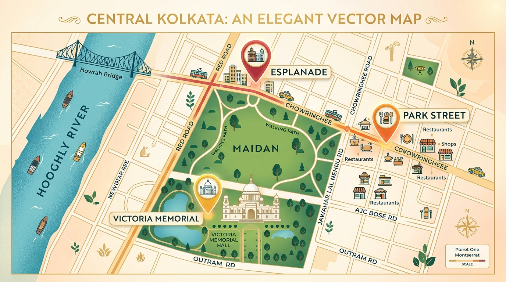
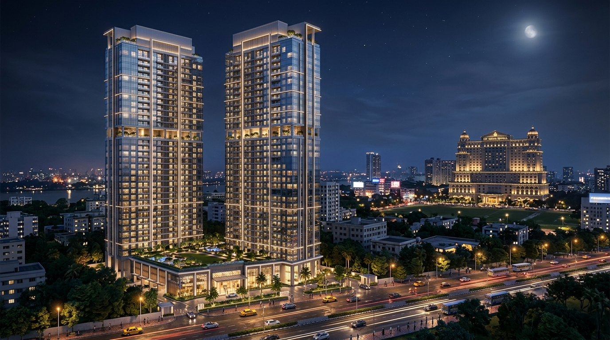
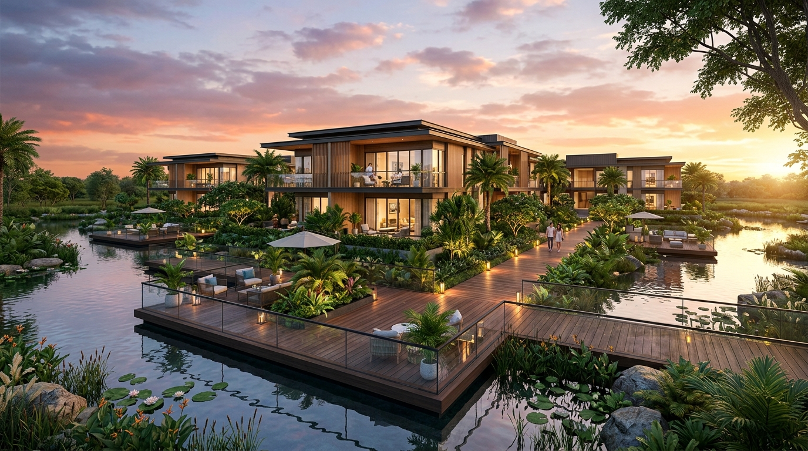
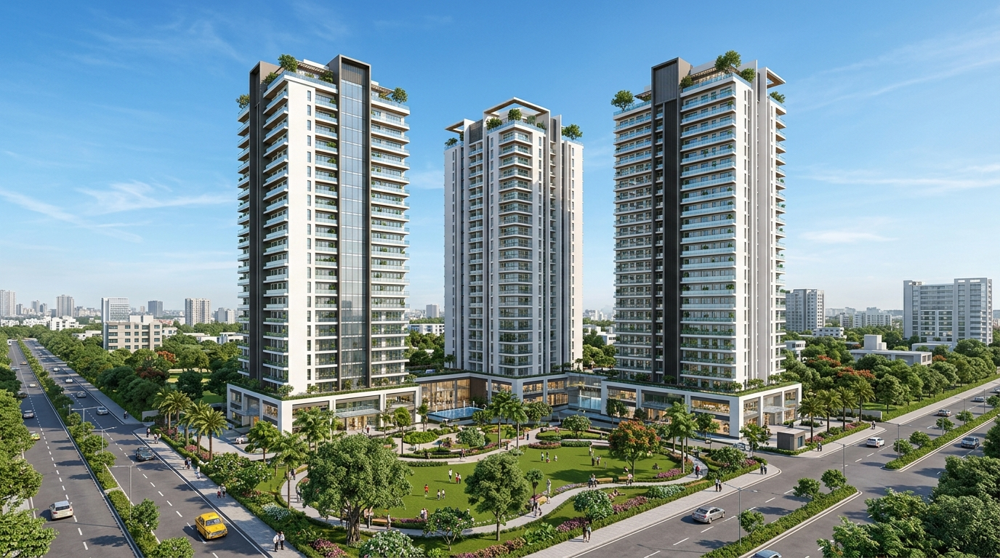
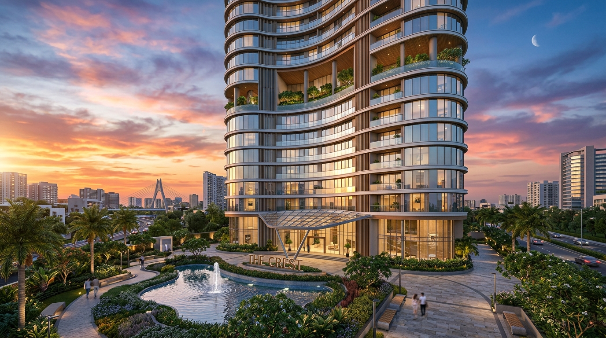
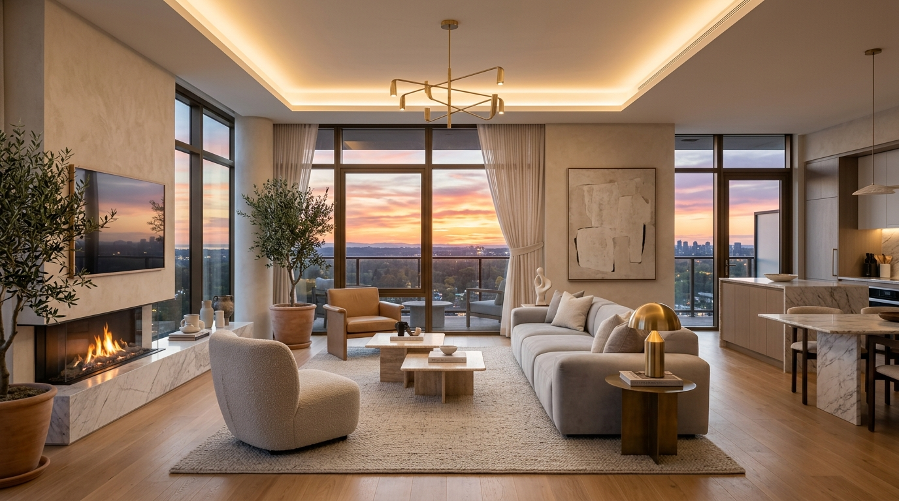
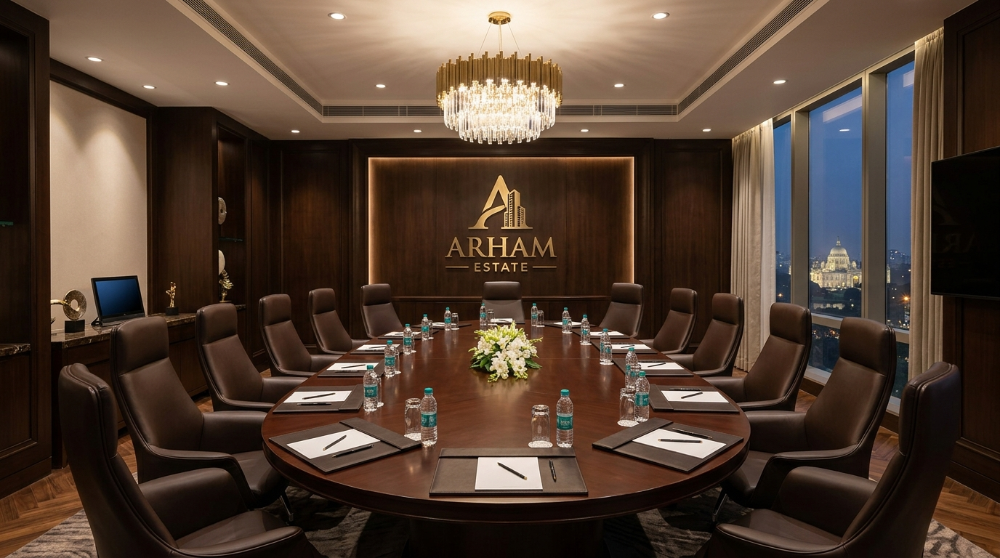

# Arham Estate — Luxury Real Estate Portal

> An open-source, premium, highly interactive real estate web application built for **Arham Estate** in Kolkata, India. This project delivers a fluid, high-end editorial experience inspired by modern luxury architecture. It features a custom logo preloader, scroll-driven SVG animations, interactive property status and specification legends, pinned presentation timelines, and a fully functional sitemap.

Built with **Next.js 16 (App Router)**, **TypeScript**, **GSAP (ScrollTrigger)**, **Lenis (Smooth Scroll)**, and **Vanilla CSS Design Tokens**.

[](LICENSE)
[](https://nextjs.org/)
[](https://www.typescriptlang.org/)
[](CONTRIBUTING.md)

---

## 🚀 What's New & Recent Improvements

- **Interactive Property & Status Legend**: Introduced reusable `PropertyLegend` component with live status badges (Ready to Move, Under Construction, New Launch), RERA compliance verification, and clickable status filters.
- **Enhanced Typography & Font System**: Optimized Google Fonts (`Outfit` and `Inter`) with full weights (300-800), `display: swap`, and fluid clamp typography scale design tokens.
- **Dynamic Property Filtering**: Real-time filtering by location, property type, budget, and construction status with instant count indicators and a reset button.
- **Smart Property Finder Matching**: Dynamic scoring algorithm matching user preferences (locations, amenities, RERA requirements) with calculated match percentages.
- **Floor Plan & Specification Matrix**: Unit layout details, facing directions (Vaastu compliant / Lake views), carpet areas, and official WBRERA registration IDs on property details pages.
- **Accessible Enquiry & Alerts**: Enhanced enquiry modal with phone/email validation, accessible ARIA live attributes, ticket reference generation, and inline error feedback.
- **Open-Source Readiness**: Added MIT License, Community Contribution Guide (`CONTRIBUTING.md`), Code of Conduct (`CODE_OF_CONDUCT.md`), GitHub Issue/PR Templates, and Security Policy (`SECURITY.md`).
- **SEO & Search Discovery**: Configured metadataBase, OpenGraph images, Twitter cards, dynamic `sitemap.ts`, and `robots.ts`.
- **Keyboard Navigation & Accessibility**: Added accessible "Skip to main content" link, focus-visible outlines, and screen reader announcements.

---

## 📋 Project Status & Milestone Checklist

- [x] **Phase 1: Brand Identity & Theme Foundation** (Custom logo preloader, ivory light theme, brand palette)
- [x] **Phase 2: Core Directory & Dynamic Routing** (App Router `properties/[slug]`, interactive property listings)
- [x] **Phase 3: Interactive Property Legend & Verification** (Status pills, RERA verification, amenities tiers)
- [x] **Phase 4: Typography & Fluid Design System** (Outfit + Inter design tokens, responsive typography clamp scale)
- [x] **Phase 5: Inquiry & Alerts Form Upgrade** (Accessible modal validation, docket ID generation)
- [x] **Phase 6: Search & Filter Algorithm** (Real-time multi-facet property finder and directory search)
- [x] **Phase 7: SEO & Social Metadata** (OpenGraph tags, XML sitemap, robots exclusion protocol)
- [x] **Phase 8: Open-Source Governance** (MIT License, community guidelines, issue templates, security policy)
- [ ] **Phase 9: Headless CMS Integration** (Planned: Strapi or Sanity backend for dynamic CMS listings)
- [ ] **Phase 10: Serverless Lead Ingestion** (Planned: Resend / SendGrid webhook for inquiry notifications)

---

## ✨ Design System & Brand Identity

The interface has been curated with a premium, high-contrast **light theme** designed for sophisticated audiences.

*   **Background (Ivory/Alabaster)**: `#FAF9F6` — Clean, warm white that reduces eye strain and feels premium.
*   **Text (Deep Slate Charcoal)**: `#0F172A` — Soft slate grey instead of harsh pure black for clean typography.
*   **Brand Highlight Green**: `#59A52C` — Represents growth, premium landscape design, and sustainability.
*   **Brand Accent Blue**: `#0BAADC` — Represents clarity, trust, and structural integrity.
*   **Status Legend Tokens**:
    *   `--status-ready`: `#15803d` (Ready to Move)
    *   `--status-construction`: `#b45309` (Under Construction)
    *   `--status-launch`: `#0369a1` (New Launch)
*   **Typography**:
    *   *Headings*: **Outfit** (Modern, bold geometric sans-serif, weights 300-800).
    *   *Body Copy*: **Inter** (Clean, highly legible neutral sans-serif, weights 300-700).

---

## 🏗️ Technical Architecture & Sitemap

The application comprises 10 custom pages and dynamic routes:

1.  **Home Page (`/`)**: Features the custom logo preloader, spotlight hero banner, pinned philosophy presentation, about segment, featured properties slider, and contact forms.
2.  **About Us (`/about`)**: Narrative hero block, 4-pillar philosophy grid (Client First, Integrity, Insight, Impact), "Rooted in Kolkata" banner, chronological process timelines, and statistics counters.
3.  **Services (`/services`)**: "Advisory that creates value" hero block, 6-card comprehensive services grid with key deliverable tags, advantage stack list, and process pipelines.
4.  **Properties Directory (`/properties`)**: Interactive property status legend, active filters panel (Location, Property Type, Budget, Status), result count indicator, detailed property grid with RERA badges, and expert requirement matching.
5.  **Property Details (`/properties/[slug]`)**: Dynamic parameters resolved using React's modern `use()` hook. Displays local breadcrumbs, details row, unit floor plan legend matrix, nearby landmarks, and a direct advisor callback form.
6.  **Property Finder (`/property-finder`)**: Interactive requirements panel (Location, Type, Budget, Configuration, Purpose dropdowns), preferences checklist, amenities tag selector, status legend, and intelligent match results checker.
7.  **Insights / Blog (`/insights`)**: Category tabs, large featured article card, sidebar recent articles list, popular cards showing reading times and research authors, and newsletter subscribe box.
8.  **Contact Us (`/contact`)**: Split forms for email messages, head office details with operating business hours, and office location cards.
9.  **Enquire Now (`/enquire`)**: Detailed requirement questionnaire card, "I am looking for" visual option cards, possession timelines, and what happens next timeline widgets.
10. **Careers (`/careers`)**: Values grid, "Why Join" section, open jobs accordion cards with specialization focus badges, benefits checklist, and resume submit card.

---

## 🖼️ Media & Asset Registry

All high-quality visual renderings are stored in `public/images/` and rendered inside the app:

### 🌆 Landmarks & Location Map
| Howrah Bridge Sunset | Hooghly Bridge Sunset | Victoria Memorial |
|:---:|:---:|:---:|
|  |  |  |

| Central Kolkata Map | Classical Head Office Facade |
|:---:|:---:|
|  |  |

### 🏢 Properties & Architecture
| Aurus Towers | Jiva Waterfront | Panache New Town | The 102 Rajarhat |
|:---:|:---:|:---:|:---:|
|  |  |  |  |

### 🛋️ Luxury Lifestyles & Interiors
| Luxury Penthouse Living Room | Corporate Boardroom |
|:---:|:---:|
|  |  |

---

## 🚀 Getting Started & Execution

### Prerequisites

- Node.js (v18 or higher recommended)
- npm or yarn

### Installation

1. Clone the repository:
   ```bash
   git clone https://github.com/JayantOlhyan/Arham-Estate.git
   cd Arham-Estate
   ```

2. Copy the environment template:
   ```bash
   cp .env.example .env.local
   ```

3. Install dependencies:
   ```bash
   npm install
   ```

4. Run the development server:
   ```bash
   npm run dev
   ```

5. Open [http://localhost:3000](http://localhost:3000) with your browser to explore the portal.

### Production Build

To verify compilation and optimize assets:

```bash
npm run build
npm run start
```

---

## 🤝 Contributing

Contributions are warmly welcome! Please see [CONTRIBUTING.md](CONTRIBUTING.md) for details on our coding standards, workflow, and pull request guidelines.

## 📜 Code of Conduct

Everyone participating in this project is expected to follow our [Code of Conduct](CODE_OF_CONDUCT.md).

## 🔒 Security

For security vulnerabilities and reporting procedures, please refer to [SECURITY.md](SECURITY.md).

## 📄 License

This project is licensed under the [MIT License](LICENSE) - see the LICENSE file for details.
